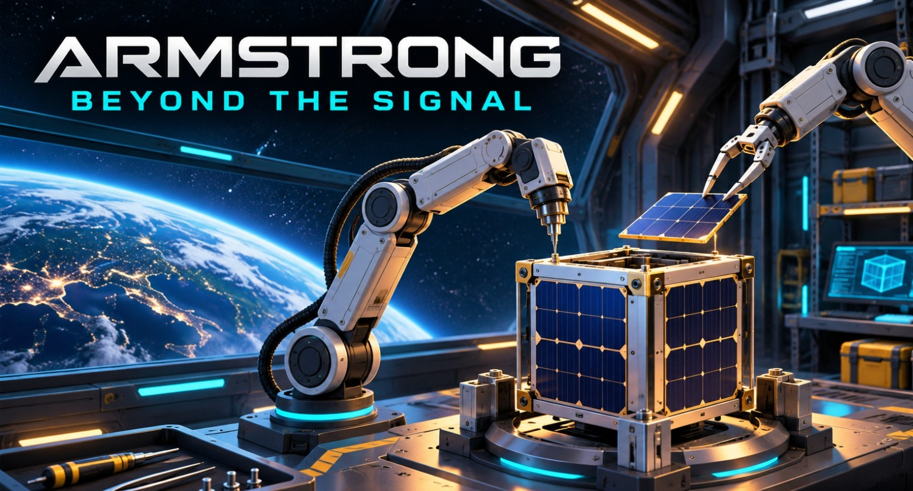

# ARMSTRONG: Beyond the Signal

**Team Caronte · NASA Space Apps Challenge 2026**

[English](#english) · [Español](#español)

## English

**A 3D educational space engineering simulator**

An incomplete transmission appears at several locations across the solar system. From an orbital workshop, you take on the role of mission architect and design the spacecraft that can recover its six fragments. A camera may meet the science objective, but it still needs enough power to operate and an antenna capable of sending the data back to Earth.

[**Web version on Unity Play**][unity-play] · [Open the project in Unity](#open-the-project-in-unity)

### From the console to orbit

1. **Choose a mission.** Review the science objective, conditions at the destination, and budget.
2. **Design the spacecraft.** Combine instruments, power sources, batteries, propulsion, and communications. Check mass, cost, and launch vehicle compatibility.
3. **Assemble and simulate.** Watch the robotic arms at work and monitor power and data transmission during the mission.
4. **Interpret the outcome.** Recover a fragment when the mission succeeds. If it fails, use the diagnostics to refine the design and try again.

The simulation uses simplified models to show how a decision about one subsystem affects the rest of the spacecraft. Compare two designs for the same destination and explain why one meets the science objective and the other falls short.

### The six missions

| Destination | Science objective | Engineering challenge |
| --- | --- | --- |
| Earth · low Earth orbit (LEO) | Observe the surface and send images back to Earth. | Balance onboard storage, data transmission, and the power available during eclipses. |
| Sun–Earth L2 point | Observe distant objects in infrared. | Maintain pointing accuracy, thermal stability, and a communications link with Earth. |
| Moon | Map the surface from orbit. | Keep systems running under changing illumination and maintain communications. |
| Mars | Observe the planet from orbit and transmit the data. | Balance propulsion, power, and communications over greater distances. |
| Jupiter and Europa | Combine images with measurements of fields and particles. | Operate with limited sunlight and withstand radiation exposure. |
| Sun | Measure the solar wind and magnetic field. | Protect the instruments from intense heat while staying within the mass budget. |

### Open the project in Unity

The prototype uses **Unity 6000.6.9f1**, **C#**, **Universal Render Pipeline (URP)**, and **Input System**. The documented build target is **Web (WebGL)** for desktop browsers.

1. Install that editor version through Unity Hub. Add the **Web Build Support** module if you plan to build for the web.
2. Add the project folder containing `Assets/`, `Packages/`, and `ProjectSettings/` to Unity Hub. Open it and wait for Unity to import the assets and resolve dependencies. The package manifest includes a GitHub-hosted package that Unity needs Git to retrieve.
3. Open [`Prototipo.unity`](Assets/Scenes/Prototipo.unity) and press **Play** to enter the workshop directly. To start with the introduction, activate **Web - Desktop - Development** under **File → Build Profiles**, then open [`Home.unity`](Assets/Scenes/Home.unity).
4. To create a build for distribution, select **Web - Desktop - Production** under **File → Build Profiles**.

### Code and documentation

- [`MissionCatalog.cs`](Assets/AssetHendrix/Scripts/MissionCatalog.cs) defines destinations, mission requirements, and component options.
- [`MissionEngine.cs`](Assets/AssetHendrix/Scripts/MissionEngine.cs) evaluates the spacecraft configuration and simulates power, storage, and data transmission.
- [`MissionControlDirector.cs`](Assets/AssetHendrix/Scripts/MissionControlDirector.cs) coordinates each mission, and [`MissionPresentation.cs`](Assets/Scripts/MissionPresentation.cs) displays recovered fragments.

| Document | Contents |
| --- | --- |
| [Game Design Document](Docs/Armstrong_Beyond_the_Signal_Game_Design_Document.pdf) | Gameplay, art direction, and learning objectives. |
| [Narrative and Missions](Docs/Armstrong_Beyond_the_Signal_Narrative_and_Missions.pdf) | Proposed script, mission briefings, and signal recovery. |
| [Software Architecture](Docs/Armstrong_Beyond_the_Signal_Software_Architecture.pdf) | Logical architecture, data model, and web distribution. |

The team consulted NASA resources when designing spacecraft subsystems and visualizing missions. [State-of-the-Art of Small Spacecraft Technology](https://www.nasa.gov/smallsat-institute/sst-soa/) · [Mission Viz](https://nasa.github.io/mission-viz/)

### Credits

**Team Caronte** led the design and final integration, with help from ChatGPT/Codex and Tripo during development. The cover is AI-generated concept art.

---

## Español

**Simulador educativo de ingeniería espacial en 3D**

Una transmisión incompleta aparece en distintos puntos del sistema solar. Desde un taller orbital, asumes el papel de arquitecto de misión y diseñas las naves capaces de recuperar sus seis fragmentos. Una cámara puede cumplir el objetivo científico, pero necesita energía para funcionar y una antena capaz de enviar los datos a la Tierra.

[**Versión web en Unity Play**][unity-play] · [Abrir el proyecto en Unity](#abrir-el-proyecto-en-unity)

### De la consola a la órbita

1. **Elige una misión.** Revisa el objetivo científico, las condiciones del destino y el presupuesto.
2. **Diseña la nave.** Combina instrumentos, fuentes de energía, baterías, propulsión y comunicaciones. Revisa la masa, el costo y la compatibilidad del lanzador.
3. **Ensambla y simula.** Observa los brazos robóticos en el taller y sigue la telemetría de energía y transmisión de datos durante la misión.
4. **Interpreta el resultado.** Recupera un fragmento si la misión tiene éxito. Si falla, usa el diagnóstico para ajustar el diseño y volver a intentarlo.

La simulación usa modelos simplificados para enseñar cómo una decisión sobre un subsistema afecta al resto de la nave. Puedes comparar dos diseños para el mismo destino y explicar por qué uno logra el objetivo científico y el otro falla.

### Las seis misiones

| Destino | Objetivo científico | Reto de ingeniería |
| --- | --- | --- |
| Tierra · órbita baja (LEO) | Observar la superficie y enviar imágenes a Tierra. | Equilibrar el almacenamiento, la transmisión y la energía disponible durante los eclipses. |
| Punto L2 del sistema Sol–Tierra | Observar objetos distantes en infrarrojo. | Mantener la precisión de apuntamiento, la estabilidad térmica y el enlace con Tierra. |
| Luna | Cartografiar la superficie desde un orbitador. | Sostener las operaciones con iluminación variable y mantener las comunicaciones. |
| Marte | Observar el planeta desde órbita y transmitir los datos. | Combinar propulsión, energía y comunicaciones a mayor distancia. |
| Júpiter y Europa | Combinar imágenes con mediciones de campos y partículas. | Operar con poca luz solar y soportar la exposición a la radiación. |
| Sol | Medir el viento solar y el campo magnético. | Proteger los instrumentos del calor intenso sin exceder el presupuesto de masa. |

### Abrir el proyecto en Unity

El prototipo está desarrollado en **Unity 6000.6.9f1**, con **C#**, **Universal Render Pipeline (URP)** e **Input System**. El destino de compilación documentado es **Web (WebGL)** para navegadores de escritorio.

1. Instala esa versión del editor desde Unity Hub. Si vas a generar una compilación web, añade el módulo **Web Build Support**.
2. Agrega a Unity Hub la carpeta raíz del proyecto, donde están `Assets/`, `Packages/` y `ProjectSettings/`. Al abrirla, espera a que Unity importe los recursos y resuelva las dependencias. El manifiesto incluye un paquete alojado en GitHub y Unity necesita Git para resolverlo.
3. Abre [`Prototipo.unity`](Assets/Scenes/Prototipo.unity) y pulsa **Play** para entrar directamente al taller. Para recorrer la introducción, activa el perfil **Web - Desktop - Development** en **File → Build Profiles** y abre [`Home.unity`](Assets/Scenes/Home.unity).
4. Para generar la versión de distribución, selecciona **Web - Desktop - Production** en **File → Build Profiles**.

### Código y documentación

- [`MissionCatalog.cs`](Assets/AssetHendrix/Scripts/MissionCatalog.cs) define los destinos, sus requisitos y las opciones de componentes.
- [`MissionEngine.cs`](Assets/AssetHendrix/Scripts/MissionEngine.cs) evalúa la configuración y simula la energía, el almacenamiento y la transmisión de datos.
- [`MissionControlDirector.cs`](Assets/AssetHendrix/Scripts/MissionControlDirector.cs) coordina el flujo de cada misión y [`MissionPresentation.cs`](Assets/Scripts/MissionPresentation.cs) muestra los fragmentos recuperados.

| Documento | Contenido |
| --- | --- |
| [Diseño del juego](Docs/Armstrong_Beyond_the_Signal_Game_Design_Document.pdf) | Mecánicas, dirección visual y objetivos de aprendizaje. |
| [Narrativa y misiones](Docs/Armstrong_Beyond_the_Signal_Narrative_and_Missions.pdf) | Guion propuesto, informes de misión y progresión de la señal. |
| [Arquitectura de software](Docs/Armstrong_Beyond_the_Signal_Software_Architecture.pdf) | Diseño lógico, modelo de datos y distribución web. |

El equipo consultó recursos de la NASA para diseñar los subsistemas y representar las misiones. [State-of-the-Art of Small Spacecraft Technology](https://www.nasa.gov/smallsat-institute/sst-soa/) · [Mission Viz](https://nasa.github.io/mission-viz/)

### Créditos

**Team Caronte** se encargó del diseño y la integración final, con apoyo de ChatGPT/Codex y Tripo durante el desarrollo. La portada es arte conceptual generado con IA.

[unity-play]: https://play.unity.com/en/games/e57efe54-900e-4e8d-ad24-b5cbe5b1bab2/armstrong-beyond-the-signal
